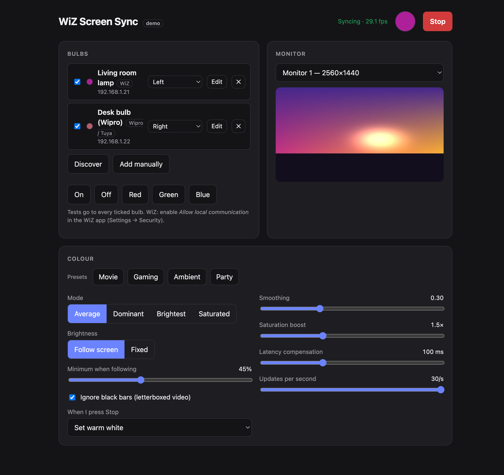
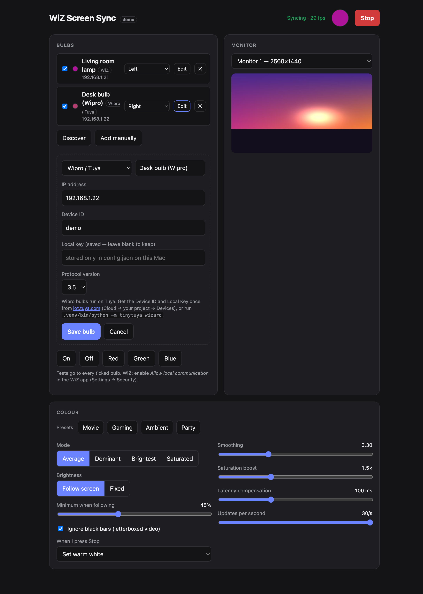

# WiZ Screen Sync

Make your smart bulbs follow whatever is on your screen. Pick a monitor, pick your bulbs, press **Start**.
Everything is controlled from a local WebUI, and every command goes to the bulbs **directly over your LAN**. No cloud, no accounts while it runs.

Works with **Philips WiZ** bulbs (local UDP) and **Wipro / Tuya** colour bulbs (local Tuya protocol), including both at the same time.



> Screenshots use the built-in demo mode (fake screen, fake bulbs), so no real desktop or network details are shown.

## Features

- **Multi-monitor.** Choose which display to sync, with a live preview, and switch while it runs.
- **Several bulbs at once, mixed brands.** WiZ and Wipro/Tuya together, each with its own on/off tick.
- **Screen zones per bulb.** Whole screen, left, right, top, bottom or centre. Put one lamp on each side of the TV and each follows its half.
- **Four colour modes.** *Average*, *Dominant* (most populous colour, ignoring near-black), *Brightest* (brightest 5% of pixels) and *Saturated* (most vivid 5%).
- **Ignore black bars.** Letterbox/pillarbox bars are trimmed before colour is picked, so movies don't go dim.
- **Presets.** One click for *Movie*, *Gaming*, *Ambient* and *Party*.
- **Low latency.** Up to 30 updates/s, rate-independent smoothing, and **latency compensation** that predicts where the colour is heading to cancel the bulb's own response time.
- **Brightness control.** Follow the screen (with a minimum floor) or hold a fixed level, plus a saturation boost.
- **When I press Stop.** Leave the bulbs alone, set warm white, or turn them off.
- **Discovery.** One button finds WiZ and Tuya bulbs on your network.
- **Secrets stay local.** Tuya local keys live only in `config.json` (mode 600) and are never sent back to the browser.
- **Demo mode.** `WIZSYNC_DEMO=1` runs the whole UI against a synthetic screen and fake bulbs, so you can try it with no hardware.

## Quick start

```bash
git clone https://github.com/shreyaskothakonda/wiz-connected-screen-sync.git
cd wiz-connected-screen-sync
./run.sh          # creates a virtualenv on first run, then serves http://127.0.0.1:8000
```

1. Open <http://127.0.0.1:8000> and press **Discover**, then add your bulbs.
2. Tick the bulbs to include, choose a monitor, press **Start**.
3. **macOS:** grant *Screen Recording* to the terminal (or app) that runs the server, in System Settings → Privacy & Security.

Try it without any hardware:

```bash
WIZSYNC_DEMO=1 .venv/bin/uvicorn app.main:app --port 8001
```

## Bulb setup

### Philips WiZ
Uses the bulb's local UDP API (port 38899). In the WiZ app enable **Settings → Security → Allow local communication**. Nothing else is needed. Discover adds the bulb in one click.

### Wipro / Tuya
Wipro smart bulbs are Tuya devices, controlled locally with [`tinytuya`](https://github.com/jasonacox/tinytuya). Each bulb has a unique **local key** that only your Tuya account holds, so you fetch it once:

1. Create a free project at [iot.tuya.com](https://iot.tuya.com) (*Cloud → Development*) in your region's data centre, and enable the **IoT Core** and **Authorization Token Management** APIs.
2. Under the project's **Devices** tab choose *Link App Account* and scan the QR code with the Wipro Next / Smart Life app.
3. Run the wizard and give it the project's Access ID, Access Secret, any Device ID, and your region:
   ```bash
   .venv/bin/python -m tinytuya wizard
   ```
4. Discover finds the bulb's IP, device ID and protocol version for you. Paste the **local key** from the wizard's output into the add-bulb form.



Notes: the bulb must be a colour (RGB) model. If commands time out, close the Wipro app on your phone, since some firmware allows one controller at a time. Re-pairing the bulb in the app generates a new key.

## Tuning for speed

The bulb itself takes roughly 100-150 ms to apply a command, which no software can remove. What the app can do:

| Setting | Effect |
| --- | --- |
| Updates per second (30) | Fresher colour; WiZ bulbs handle 30/s without queuing |
| Smoothing (0.1) | Lower is snappier; higher hides flicker on fast cuts |
| Latency compensation (100 ms) | Sends where the colour will be after the bulb's delay; try 0-200 |

## How it works

```
mss capture ─▶ crop black bars ─▶ per-zone colour extraction ─▶ saturation ─▶ smoothing
                                                                         │
                       WiZ: UDP setPilot ◀──────── bulbs ◀──── lead prediction
                       Tuya: tinytuya (worker thread, latest frame wins)
```

- `app/capture.py` multi-monitor capture (`mss`) and the demo capturer
- `app/color.py` extraction modes, black-bar and zone crops, smoothing
- `app/engine.py` settings, presets and the sync loop (one pipeline per zone)
- `app/bulb.py` WiZ UDP client, Tuya client, discovery
- `app/main.py` FastAPI app and API; `app/static/index.html` is the whole UI (no build step)

## Configuration & tests

Settings persist in `config.json` (git-ignored, because it holds Tuya keys). See `config.example.json` for the shape. `WIZSYNC_CONFIG=/path/to/file.json` points the app at another file.

```bash
.venv/bin/pytest      # unit + engine tests, no hardware needed
```

## Security

The server binds to `127.0.0.1` only and has no authentication, so don't expose it to your network. Keep `config.json`, `tinytuya.json`, `devices.json` and `snapshot.json` private; they're in `.gitignore`.
